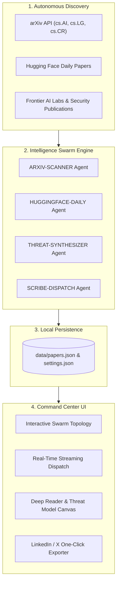

<div align="center">

# 🌐 OpenRadar AI
### Autonomous AI Research Swarm & Threat Intelligence Command Center

[](https://opensource.org/licenses/MIT)
[](https://nextjs.org/)
[](https://tailwindcss.com/)
[](https://www.typescriptlang.org/)
[](https://python.org/)

**OpenRadar AI** is an open-source autonomous intelligence platform designed to scan, filter, and synthesize frontier AI research papers in real time. It monitors arXiv, Hugging Face, and frontier lab publications, evaluates relevance against custom threat models and agent architectures, and delivers executive briefs with one-click social post generation.

[Features](#-key-features) • [Quick Start](#-quick-start) • [Architecture](#-architecture) • [Customization](#-customizing-focus-topics) • [Contributing](#-contributing)

</div>

---

## ⚡ Key Features

- **Autonomous Multi-Source Ingestion**:
  - Automatically queries **arXiv** categories (`cs.AI`, `cs.LG`, `cs.CR` for security & threat modeling).
  - Continuously monitors **Hugging Face Daily Papers**.
  - Curates frontier lab publications (Anthropic, OpenAI, DeepMind, Stanford, Berkeley).

- **Swarm Map & Cyber Command Center UI**:
  - Built with frosted glassmorphism, radial glows, and cyber grid layouts inspired by modern agent orchestrators.
  - Interactive **Swarm Map View** showing distributed agent nodes (`NEXUS-CORE`, `ARXIV-SCANNER`, `THREAT-SYNTHESIZER`, etc.).
  - Split **Streaming Dispatch** feed and deep reader studio.

- **Automated Threat Modeling & Relevance Scoring**:
  - Scores every paper from 0 to 100% based on semantic alignment with your key technical focus areas.
  - Generates specialized **Security & Threat Model Alerts** analyzing risks of runtime escape, rogue replication, and decentralized edge swarms.

- **One-Click LinkedIn & Executive Draft Generator**:
  - Automatically translates dense academic papers into punchy, insight-driven summaries ready to publish with one click.

- **Dual-Mode Execution**:
  - Use the full-featured **Next.js Web UI** with on-demand discovery triggers.
  - Or run the lightweight **Python CLI Agent (`agent_scan.py`)** headless via terminal or automated cron jobs.

---

## 🏗️ Architecture



---

## 🚀 Quick Start

### Prerequisites
- Node.js 18+ and npm
- Python 3.9+ (for CLI agent scans)

### 1. Clone & Install
```bash
git clone https://github.com/MusayevAhmad/openradar-ai.git
cd openradar-ai
npm install
```

### 2. Start the Command Center UI
```bash
npm run dev
```
Open **[http://localhost:3000](http://localhost:3000)** in your browser.

### 3. Run Standalone Agent Discovery (CLI)
You can trigger ingestion and paper synthesis directly without opening the browser:
```bash
python3 agent_scan.py
```

---

## 🎯 Customizing Focus Topics

You can tune the agent's target interests directly in the UI via the **Sliders** icon, or by editing `data/settings.json`:

```json
{
  "topics": [
    "Autonomous AI Agents & Multi-Agent Systems",
    "AI Safety, Alignment & Threat Models",
    "Edge AI & Distributed Low-Power Inference",
    "Mechanistic Interpretability & Model Steerability",
    "Model Distillation & Efficient Reasoning"
  ],
  "keywords": [
    "agent", "autonomous", "threat model", "self-replicating", "edge",
    "distillation", "reasoning", "alignment", "inference", "jailbreak"
  ],
  "minScore": 65
}
```

---

## 🤝 Contributing

Contributions, issues, and feature requests are welcome! Check out [CONTRIBUTING.md](CONTRIBUTING.md) to get started.

---

## 📄 License

This project is licensed under the [MIT License](LICENSE).
